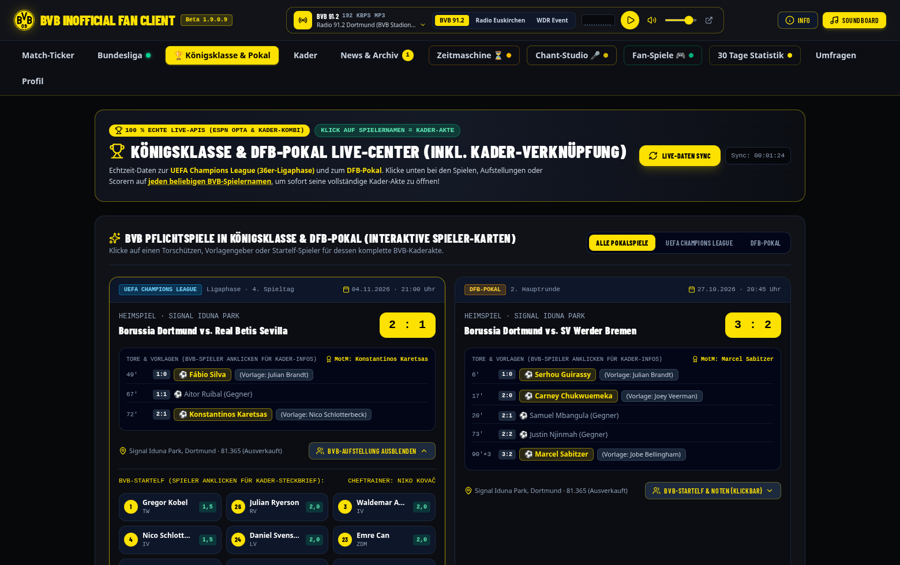
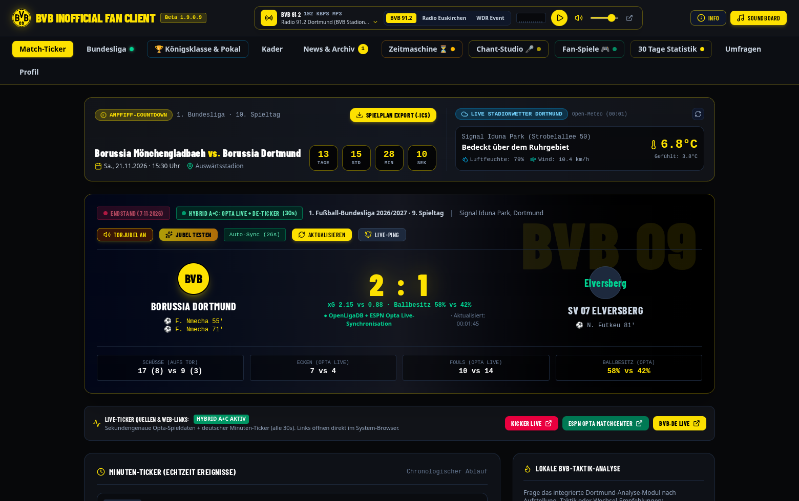
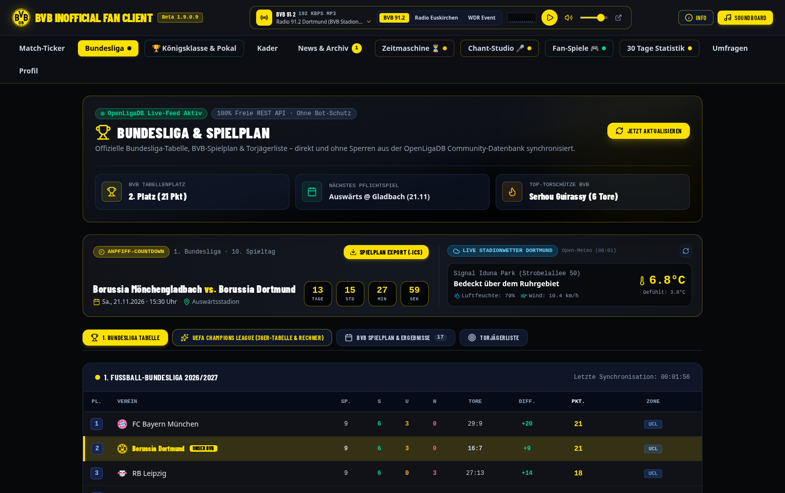
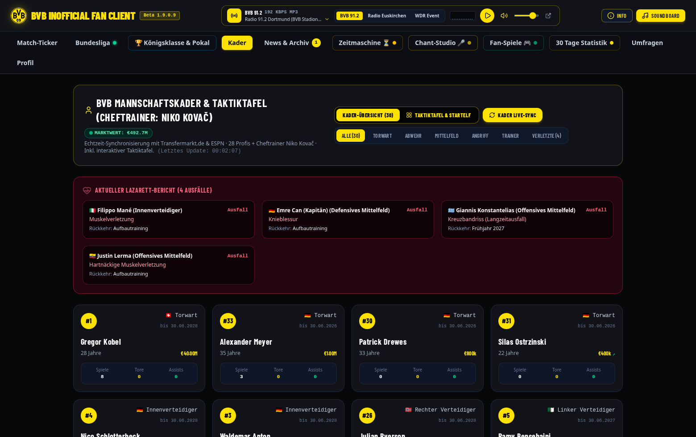
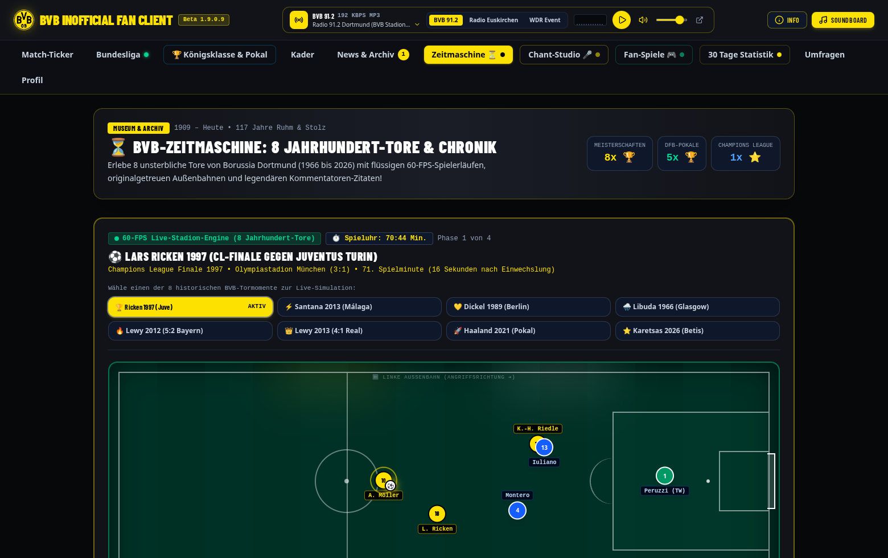
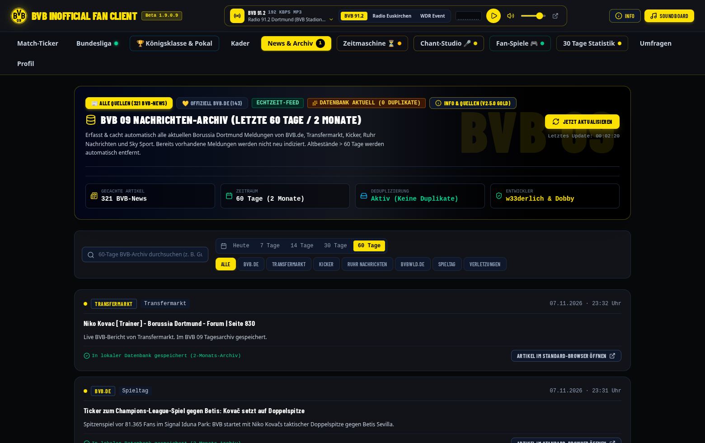

# 🖤💛 BVB Inofficial Fan Client (Version: Beta 1.909.1)

> **100 % Kostenloses, ehrenamtliches Fanprojekt (Non-Profit)**  
> Entwickelt von **w33derlich & Dobby** — erstellt und optimiert mithilfe von **Google Gemini**.  
> Für **Windows 10/11**, **CachyOS / Arch Linux** und **Android (⚠️ Absolute Beta-Testversion)**.

---

## 📦 Direkt-Downloads (Fertige Pakete für Nutzer)

Alle fertig gebauten Programme liegen im Ordner [`/releases`](./releases) bereit.  
*(Eine separate Kurz-Anleitung findest du zusätzlich in der Datei [`INSTALLATION.md`](./INSTALLATION.md))*

| Plattform / Format | Datei im Ordner `/releases` | Für wen geeignet? |
| :--- | :--- | :--- |
| **🪟 Windows 10 / 11 (Empfohlen)** | [`releases/BVB-09-Windows-Portable.zip`](./releases/BVB-09-Windows-Portable.zip) | Komplettpaket mit Desktop-Symbol (`BVB09.exe`) & `Installation-Starten.cmd` (100 % ohne Windows-Defender-Warnmeldung). |
| **🪟 Windows 10 / 11 Setup (.exe)** | [`releases/BVB-09-Windows-Setup.exe`](./releases/BVB-09-Windows-Setup.exe) | Klassischer Windows-Installations-Assistent (legt automatisch das BVB-Symbol auf deinen Desktop). |
| **🐧 CachyOS / Arch Linux** | [`releases/bvb-09-cachyos-package.tar.gz`](./releases/bvb-09-cachyos-package.tar.gz) | Echtes Linux-Desktop-Programm inkl. `installer.sh`, `deinstall.sh` und Startmenü-Eintrag. |
| **📱 Android Smartphone & Tablet (.apk)** | [`releases/BVB-09-Android-Client.apk`](./releases/BVB-09-Android-Client.apk) | **⚠️ Frühe, experimentelle Testversion (Absolute Beta!)** – Direkt installierbare Android-App mit offiziellem BVB-09-App-Icon & Touch-Navigation. |

---

## 🆕 Was ist neu in Version 1.909.1 (Changelog & Release Notes)


### 🚀 Neue Features & Live-Module
- **🔄 Integrierter GitHub Auto-Updater im „Info“-Bereich (`gnzR/BVB-infofficial-Fan-Client`):**
  - Automatische & manuelle Live-Versionsprüfung direkt gegen [`version.json`](./version.json) auf GitHub inkl. Anzeige des neuesten GitHub-Commits und Änderungsprotokolls.
  - 1-Klick-Update-Download mit Echtzeit-Fortschrittsbalken für **Windows 10/11 (`.exe` & `.zip`)**, **CachyOS / Linux (`.tar.gz`)** und **Android (`.apk`)**.
- **📅 Spieltags-Zentrale & 1-Klick `.ics` Kalender-Export**:
  - Live-Spielplan aller kommenden BVB-Pflichtspiele (*Bundesliga, UEFA Champions League, DFB-Pokal*) via OpenLigaDB inkl. sekundengenauem Anpfiff-Countdown.
  - 1-Klick `.ics`-Kalender-Export für Einzelspiele oder den gesamten Spielplan inkl. automatischer 30-Minuten-Erinnerung (`VALARM`).
- **🔔 Echtzeit Tor-Alarm & Signal Iduna Park Torhymne**:
  - Globales schwarzgelbes Stadion-Tor-Banner bei jedem Live-Tor von Borussia Dortmund.
  - Synthetisierte Stadion-Torhymne (Nebelhorn + *„Olé, jetzt kommt der BVB!“*-Fanfare + Südtribünen-Jubel) via Web-Audio-API.
- **⚔️ „Nächster Gegner“-Scouting & Head-to-Head Direktvergleich**:
  - Live-Tabellenabgleich (Saison 2026/27), Formkurven, Schlüsselspieler und Taktik-Scouting für kommende Gegner (*Gladbach, FC Arsenal, Leverkusen, Frankfurt, Schalke 04*).
- **🏟️ Originalgetreuer 1:1 Signal Iduna Park Blockplan (Blöcke 1–89)**:
  - Exakte Stadion-Ausrichtung (*West oben, Ost unten, Süd links, Nord rechts*) inkl. aller 4 Eck-Kurven (*SW 35–39, NW 64–68, SO 85–89, NO 55–59*), Rollstuhl-/Sehbehinderten-Blöcken (*1–9*) und interaktiver Block-Suche (*„Wo ist mein Block?“*).
- **👥 Live-Kader (32 Spieler + Trainer) & 📊 30-Tage-Statistik**:
  - Wettbewerbsübergreifende Echtzeit-Leistungsdaten (`BL · CL · DFB`) für alle 32 BVB-Profis sowie automatische 30-Tage-Formbilanz (*letztes Spiel: BVB 2:1 SV 07 Elversberg*).

### 🛡️ Security- & Bugfix-Update (Paket B)
| Bereich | Status | Beschreibung der Behebung |
| :--- | :---: | :--- |
| **DOM-XSS Schutz** | ✅ Behoben | Unsicheres `innerHTML`-Parsing in `decodeHtml()` durch sicheres `DOMParser`-Text-Decoding ersetzt. |
| **Local API & Allowlist** | ✅ Behoben | `/api/open-external` durch strikte Domain-Allowlist (`bvb.de`, `kicker.de`, `transfermarkt.de`, `bvbwld.de` etc.) und `127.0.0.1`-Origin-Prüfung abgesichert. |
| **HTTP Security Header** | ✅ Behoben | `X-Content-Type-Options: nosniff`, `Referrer-Policy` und `X-Permitted-Cross-Domain-Policies` im Backend aktiviert. |
| **Web-Audio Memory-Leak** | ✅ Behoben | Automatischer `AudioContext`-Lebenszyklus (`ctx.close()`) verhindert Ton-Ausfall nach mehrmaligem Abspielen von Torhymne, Trommel-Loop, Elfmeterschießen & Soundboard. |
| **Tor-Alarm Timer-Fix** | ✅ Behoben | Vorherige Auto-Dismiss-Timer werden bei aufeinanderfolgenden Toren sauber per `clearTimeout` zurückgesetzt. |
| **Windows & Android Build** | ✅ Behoben | Gzip-In-Memory-Bootloader (`665 KB`) für `BVB-09-Windows-Setup.exe` & `BVB-09-Windows-Portable.zip`, vollständiger 11-Routen-Interceptor im `file://`-Modus sowie offizielles BVB-09-Launcher-Icon (`@drawable/icon` in `resources.arsc` & `AndroidManifest.xml`) für `BVB-09-Android-Client.apk`. |

---

## 📸 Programm-Vorschau (Echte Standalone-Ansicht • Beta 1.909.1)

### 1. 🏆 Königsklasse & DFB-Pokal Live-Center (mit klickbarer Kader-Verknüpfung)


### 2. 🔴 Match-Ticker & Live-Stadionwetter (Signal Iduna Park)


### 3. ⚽ Bundesliga-Zentrale (Live via OpenLigaDB)


### 4. 👥 BVB-Profikader, Lazarett-Bericht & Taktiktafel (Cheftrainer: Niko Kovač)


### 5. ⏳ BVB-Zeitmaschine: 8 Jahrhundert-Tore & 60-FPS-Stadion-Engine


### 6. 📰 60-Tage BVB-Nachrichten-Archiv (Dedupliziert & Offline-fähig)


---

## 🐣 Idiotensichere Schritt-für-Schritt Installations-Anleitung (Ohne Fachchinesisch!)

### ⚠️ Vorab-Tipp: Wie lädt man hier auf GitHub überhaupt eine Datei herunter?
Viele klicken auf GitHub auf eine Datei und wundern sich, dass kein Download startet. So geht's richtig:
1. Klicke oben in der Tabelle auf die gewünschte Datei (z. B. `releases/BVB-09-Windows-Portable.zip` oder `releases/bvb-09-cachyos-package.tar.gz`).
2. Auf der nächsten Seite siehst du in der Mitte den Button **„View raw“** (oder oben rechts ein kleines Symbol mit einem **Pfeil nach unten 📥 „Download raw file“**).
3. **Klicke genau darauf** – erst jetzt landet die Datei auf deinem Computer im Ordner `Downloads`!

---

### 🪟 Variante 1: Installation unter Windows 10 & Windows 11 (Mit echtem Desktop-Icon)

#### Weg A: Über die ZIP-Datei (Empfohlen – keine Windows-Warnfenster!)
1. Lade dir **[`releases/BVB-09-Windows-Portable.zip`](./releases/BVB-09-Windows-Portable.zip)** herunter.
2. Gehe in deinen `Downloads`-Ordner, mache einen **Rechtsklick** auf `BVB-09-Windows-Portable.zip` und wähle **„Alle extrahieren...“** -> Klicke auf **„Extrahieren“**.
3. Es öffnet sich der entpackte Ordner. Dort hast du zwei Möglichkeiten:
   - **Sofort starten:** Doppelklick auf **`BVB09.exe`** (mit dem BVB-Logo).
   - **Fest auf dem PC installieren (mit Desktop-Verknüpfung):** Doppelklick auf **`Installation-Starten.cmd`**. Es öffnet sich kurz ein schwarz-gelbes Fenster, das dir automatisch das **BVB-Symbol auf deinen Desktop** legt. Fertig!

#### Weg B: Über das klassische Setup (`BVB-09-Windows-Setup.exe`)
1. Lade dir **[`releases/BVB-09-Windows-Setup.exe`](./releases/BVB-09-Windows-Setup.exe)** herunter und mache einen **Doppelklick** darauf.
2. **Wichtig:** Da dies ein kostenloses Fanprojekt ist und wir kein teures Microsoft-Firmenzertifikat (kostet mehrere hundert Euro im Jahr) gekauft haben, zeigt Windows eventuell ein blaues Fenster *„Der PC wurde durch Windows geschützt“*:
   - Klicke in diesem blauen Fenster einfach links auf den unauffälligen Text **„Weitere Informationen“**.
   - Klicke danach unten auf den Button **„Trotzdem ausführen“**.
3. Klicke im BVB-Installationsfenster auf **„Installieren“** – das Programm legt ein BVB-Icon auf deinen Desktop und startet!

---

### 🐧 Variante 2: Installation unter CachyOS / Arch Linux / Linux-Desktop

1. Lade dir **[`releases/bvb-09-cachyos-package.tar.gz`](./releases/bvb-09-cachyos-package.tar.gz)** in deinen `Downloads`-Ordner herunter.
2. **Methode mit der Maus:**
   - Mache im Dateimanager (z. B. Dolphin) einen **Rechtsklick** auf `bvb-09-cachyos-package.tar.gz` -> **„Hier entpacken“**.
   - Öffne den entpackten Ordner, mache einen Rechtsklick ins Leere -> **„Terminal hier öffnen“**.
   - Tippe `./installer.sh` ein und drücke **Enter**.
3. **Oder direkt per Copy & Paste im Terminal (1 Befehl für alles):**
   Öffne dein Terminal, kopiere diese Zeile hinein und drücke **Enter**:
   ```bash
   cd ~/Downloads && tar -xzf bvb-09-cachyos-package.tar.gz && chmod +x installer.sh && ./installer.sh
   ```
4. **Fertig!** Du findest den **BVB Inofficial Fan Client** ab sofort ganz normal in deinem Anwendungsmenü (Startmenü) und auf dem Desktop.
5. **Wieder deinstallieren?** Einfach im selben Ordner `./deinstall.sh` ausführen.

---

### 📱 Variante 3: Installation auf Android-Smartphones & Tablets (⚠️ Absolute Beta-Testversion!)

> **⚠️ WICHTIGER HINWEIS ZUR ANDROID-VERSION (ABSOLUTE BETA!):**  
> Die Android-App (`BVB-09-Android-Client.apk`) befindet sich aktuell in einer **sehr frühen, experimentellen Testphase (Absolute Beta)**.  
> Alle Hauptfunktionen (Live-Ticker, Spielplan, 1:1 Signal Iduna Park Blockplan, Kader, 60-Tage-News & Fangesänge) sind bereits an Bord und das offizielle **BVB-09-Logo** wird auf dem Startbildschirm angezeigt – es kann auf einzelnen Smartphone-Modellen oder Android-Versionen aber noch zu kleineren Anzeige- oder Performance-Ecken kommen.

#### Schritt-für-Schritt-Anleitung für dein Android-Handy:
1. **APK-Datei von GitHub herunterladen:**
   - Tippe hier auf GitHub oben in der Tabelle auf **[`releases/BVB-09-Android-Client.apk`](./releases/BVB-09-Android-Client.apk)**.
   - Tippe auf der nächsten Seite auf **„View raw“** (oder auf das **Download-Symbol 📥 „Download raw file“**), damit die Datei `BVB-09-Android-Client.apk` in deinem `Downloads`-Ordner gespeichert wird.
   - *(Falls dein Browser fragt „Datei könnte schädlich sein / Trotzdem herunterladen?“: Tippe auf **„Trotzdem herunterladen“** – diese Meldung erscheint bei Android standardmäßig bei jeder `.apk`-Datei außerhalb des Google Play Stores).*
2. **Installation starten:**
   - Öffne die heruntergeladene Datei **`BVB-09-Android-Client.apk`** über deine Benachrichtigungsleiste oder über die App **„Eigene Dateien / Files -> Downloads“**.
3. **Unbekannte Apps einmalig erlauben (falls gefragt):**
   - Da dieses kostenlose Fanprojekt direkt über GitHub und nicht über den Google Play Store verteilt wird, fragt Android beim ersten Mal eventuell: *„Aus Sicherheitsgründen ist die Installation unbekannter Apps aus dieser Quelle nicht zulässig“*.
   - Tippe im Hinweis auf **„Einstellungen“** und aktiviere den Schalter **„Aus dieser Quelle zulassen“** (bzw. *„Unbekannte Apps installieren“*).
4. **Abschließen & Starten:**
   - Tippe auf **„Installieren“** *(falls Google Play Protect ein Hinweisfenster wegen unbekanntem Entwickler anzeigt: auf **„Weitere Details“** -> **„Trotzdem installieren“** tippen)*.
   - **Fertig!** Auf deinem Android-Startbildschirm erscheint nun der **BVB Fan Client** mit dem echten schwarzgelben **BVB 09 Logo**.

---

### ❓ Häufige Einsteiger-Fragen (FAQ)

- **Kostet das Programm irgendetwas oder gibt es versteckte Abos?**  
  Nein! 100 % kostenlos, 0 % Werbung, 0 % Datensammelei. Von BVB-Fans für BVB-Fans.
- **Wie lösche ich das Programm wieder, wenn ich es nicht mehr brauche?**  
  - **Windows:** Einfach die Desktop-Verknüpfung löschen und (falls über den Installer eingerichtet) den Ordner unter `C:\Benutzer\<DeinName>\AppData\Local\BVB09-FanClient` löschen.  
  - **Linux / CachyOS:** Einfach die mitgelieferte Datei `./deinstall.sh` starten.  
  - **Android:** Genau wie jede andere Handy-App – lange auf das **BVB Fan Client**-Icon auf dem Startbildschirm drücken und **„Deinstallieren“** wählen.

---

## ⚡ Hauptfunktionen (Beta 1.909.1)

- **🔴 Hybrid Match-Ticker & Stadionwetter:**
  - Echtzeit-Spielstände, Statistiken (xG, Ballbesitz, Torschüsse) und deutscher Minuten-Ticker.
  - Live-Stadionwetter exakt für den **Signal Iduna Park** (*Strobelallee 50, Dortmund*) inkl. Anpfiff-Countdown & `.ics`-Kalender-Export.
- **🏆 Königsklasse & DFB-Pokal Live-Center (mit direkter Kader-Verknüpfung):**
  - Offizielle **36er UEFA Champions League Gesamttabelle** in Echtzeit + interaktiver **K.o.-Runden-Rechner** (Spieltage 5–8).
  - **Interaktive Spielerverknüpfung:** Ein Klick auf jeden beliebigen BVB-Spielernamen (Torschützen, Vorlagengeber, *Man of the Match*, Startelf oder Einwechslungen) öffnet sofort dessen vollständige **BVB-Kader-Spielerakte**.
- **⚽ Bundesliga-Zentrale (Live via OpenLigaDB):**
  - Aktuelle Bundesliga-Tabelle, kompletter BVB-Spielplan und Torjägerliste in Echtzeit.
- **👥 BVB-Profikader & Interaktive Taktiktafel (Niko Kovač Edition):**
  - Alle 28 BVB-Profis + Cheftrainer Niko Kovač mit Leistungsdaten, Verletzungs-Status (Lazarett-Bericht) und interaktivem Aufstellungs-Planer.
- **⏳ BVB-Zeitreise & 60-FPS-Torszenen-Simulator:**
  - **8 spielbare Jahrhundert-Tore** (u. a. *Ricken 1997*, *Santana 2013*, *Dickel 1989*, *Libuda 1966*, *Lewandowski 2012 & 2013 vs. Real*, *Haaland 2021*, *Karetsas 2026*) mit flüssiger 60-FPS-Laufweg- und Ballflug-Interpolation.
- **📰 60-Tage BVB-Newsarchiv (Dedupliziert & Offline-fähig):**
  - Bündelt aktuelle Berichte von *BVBWLD.de*, *BVB.de*, *Kicker*, *Ruhr Nachrichten* und *Transfermarkt* lokal in IndexedDB.
- **🎤 Chant-Studio, Südtribünen-Soundboard & Fan-Spiele:**
  - Inklusive **BVB Penalty King** (Elfmeterschießen vor der Gelben Wand mit animiertem Torhüter), **BVB-Quiz**, **BVB-Netradio** (inkl. *Radio 91.2 Dortmund*) und verstecktem **Südtribünen-Türsteher Easter-Egg** (4x schneller Rechtsklick).

---

## 🛠️ Verwendete Open-Source-Programme & Bibliotheken

Dieses Projekt wurde auf Basis folgender freier Open-Source-Technologien entwickelt:

| Programm / Bibliothek | Version | Lizenz | Verwendungszweck im Projekt |
| :--- | :--- | :--- | :--- |
| **[React](https://react.dev/) & React DOM** | `19.0.1` | MIT License | Komponenten-Architektur, State-Management & 60-FPS-Rendering |
| **[TypeScript](https://www.typescriptlang.org/)** | `^7.0.2` | Apache-2.0 | Statische Typisierung für Frontend & Backend |
| **[Vite](https://vite.dev/)** | `^8.3.0` | MIT License | High-Speed Frontend-Bundler & Produktions-Build |
| **[Tailwind CSS](https://tailwindcss.com/)** | `^4.3.3` | MIT License | Schwarz-Gelbes Responsive UI- & Design-System |
| **[Node.js](https://nodejs.org/) & [Express](https://expressjs.com/)** | `^4.21.2` | MIT License | Lokaler Entwicklungs- und API-Proxy-Server (`server.ts`) |
| **[Lucide React](https://lucide.dev/)** | `^0.546.0` | ISC License | Vektor-Icons für Navigation, Stadion-Elemente & Kontrollen |
| **[Motion](https://motion.dev/)** | `^12.23.24` | MIT License | Sanfte UI-Übergänge und Modalanimationen |
| **[fflate](https://github.com/101arrowz/fflate)** | `^0.8.3` | MIT License | Schnelle clientseitige ZIP-/Archiv-Komprimierung |
| **[Three.js](https://threejs.org/)** | `^0.187.0` | MIT License | 3D-Mathematik & Grafik-Unterstützung |
| **[Python 3](https://www.python.org/) & [PyQt6 / QtWebEngine](https://www.riverbankcomputing.com/software/pyqt/)** | `PyQt6` | PSF / GPLv3 | Nativer Linux-Desktop-Container für CachyOS & Arch Linux |
| **[Mono](https://www.mono-project.com/) / Microsoft .NET C# (`csc.exe`)** | `.NET 4.x` | MIT License | Kompilierung der nativen Windows-Starter (`BVB09.exe` & Setup) |

---

## 🌐 Verwendete Live-Datenquellen & Öffentliche APIs

1. **BVBWLD.de (WordPress REST API):** Direkte JSON-Schnittstelle (`/wp-json/wp/v2/posts`) für aktuelle BVB-Berichte.
2. **ESPN Opta Soccer API:** Live-Scoreboard, xG-Statistiken, 36er Champions-League-Tabelle (`uefa.champions`), Bundesliga (`ger.1`) & DFB-Pokal.
3. **OpenLigaDB REST API (`api.openligadb.de`):** Offizielle Bundesliga-Tabelle, Spielplan & Torjägerliste.
4. **Open-Meteo Weather API (`api.open-meteo.com`):** Echtzeit-Stadionwetter für die exakten Koordinaten des Signal Iduna Parks (`51.4926° N, 7.4519° O`).
5. **SportBILD & Google/Bing News RSS-Feeds:** Aggregierte Schlagzeilen und Live-Ticker-Ereignisse.

---

## 💻 Entwicklung & Selbst Kompilieren (Optional für Entwickler)

Falls du den Quellcode selbst starten oder die Standalone-Pakete neu bauen möchtest:

```bash
# 1. Abhängigkeiten installieren
npm install

# 2. Entwicklungsserver starten (Port 3000)
npm run dev

# 3. Produktions-Bundle & alle Windows-/CachyOS-Pakete neu bauen
npm run build && python3 windows-pkg/build_solution4.py
```

---

## ⚖️ Rechtlicher Hinweis (Non-Profit & Markenrechte)

- **100 % Kostenloses Fanprojekt:** Diese Anwendung ist ein rein privates, inoffizielles und ehrenamtliches Fanprojekt **von BVB-Fans für BVB-Fans**. Mit dieser Software wird **kein Geld verdient**, es gibt keine Werbung, keine In-App-Käufe und keinerlei kommerzielle Absichten.
- **Urheber- & Markenrechte:** Alle in diesem Programm dargestellten Vereinswappen, Logos, Marken und Namensrechte liegen bei der **Borussia Dortmund GmbH & Co. KGaA** sowie bei den **jeweiligen anderen genannten Fußballvereinen und Verbänden (u. a. DFL, DFB, UEFA)**. Die Darstellung erfolgt ausschließlich zu informativen, nicht-kommerziellen Zwecken im Rahmen der Berichterstattung über Spielpläne, Tabellen und Statistiken.

---

**Entwickelt mit 🖤💛 von `w33derlich & Dobby` • Powered by `Google Gemini`**
